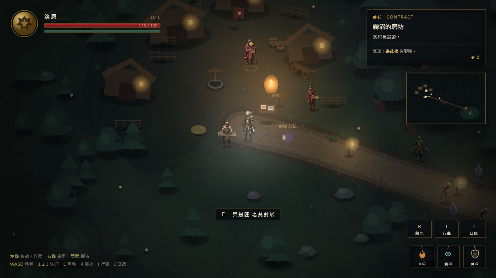

# 灰狼：霧沼之獸 · Grey Wolf: Beast of the Mist Marsh

一個純 HTML5 Canvas 2D、零框架、零依賴的暗黑奇幻動作 RPG 垂直切片（vertical slice）。
單一 `index.html` ＋ 46 個 PNG sprite，全程唔需要 build step。

### ▶ 直接玩：<https://chengyukpong.github.io/alan-game/>

按 **Enter** 開始。桌面瀏覽器（Edge／Chrome／Firefox／Safari）為準。

## 玩法

| 操作 | 作用 |
|---|---|
| 滑鼠左鍵 | 移動／攻擊 |
| WASD | 移動 |
| 空白鍵／右鍵 | 翻滾閃避 |
| `1` / `2` / `3` | 炎印／震印／盾印 |
| `E` | 互動 |
| `I` / `J` / `R` | 行囊／日誌／藥水 |
| 雙擊 | 翻滾 |

## 內容

- **主線**：沼澤磨坊的委託 → 清怪 → 妖靈巢穴 → 神龕召喚 Boss → 最後抉擇 → 三幕後日談。
- **支線**：補給車、狼人詛咒（含 1.9 秒變身動畫）、獵人任務。
- **系統**：等級／金錢／裝備升級、銀劍對怪物加成、劍油、藥水、寶箱掉落、任務倍率。
- **表現**：8 方向 idle／walk 動畫、Boss 音樂分層、程序化配樂引擎、震屏、粒子、便攜存檔（localStorage）。
- **46 項內建自動測試**：`?test=1`，目前 **46/46**。

## 開發用參數

| 參數 | 作用 |
|---|---|
| `?test=1` | 跑 46 項內建自動測試 |
| `?play=1&fresh=1` | 直接開新遊戲 |
| `?pos=mill` / `?pos=side` | 傳送到磨坊／支線沼澤 |
| `?pose=combat` / `?pose=boss` / `?pose=matriarch` / `?pose=were` / `?pose=cure` | 定格場景（`cure`＝變身中） |
| `?pose=dirs` | 8 方向 idle／walk 展示 |
| `?dialog=elder` / `?dialog=widow` / `?dialog=werewolf` | 指定對話 |
| `?show=inventory` / `?show=journal` / `?show=smith` | 展示面板 |
| `?epilogue=1` | 直接看後日談 |
| `?dirs=0` | 停用 8 方向動畫 |

## 技術

- 單檔 `index.html`（約 176 KB）內嵌全部遊戲邏輯與 CSS；美術以相對路徑 `assets/` 載入 —— 因此任何靜態主機（GitHub Pages／S3／itch.io）都可以直接託管。
- 無 `fetch`／XHR／外部 CDN 請求，離線可玩，載入後無網路需求。
- 存檔只用 `localStorage`。

## 本倉庫與原作嘅關係

本版《灰狼：霧沼之獸》由同名 fans 版以 `tools/make_original_ip.py` 自動改名而來
（傑洛特→洛恩、維倫→霧沼、水鬼→沼屍、妖靈→夜泣、狼學派→狼紋、伊格尼／阿爾德／昆恩→炎印／震印／盾印、阿蓮→莉婭），
程式邏輯與關卡不變。本倉庫**只收錄改名後的原創版**，不含任何《巫師》角色名或地名。

角色 sprite 由 SDXL 本地生成（AI 生成內容）。若要正式商業發佈，建議用原創角色設定重新生成美術，
並自行確認世界觀與美術版權。

## License

程式碼採 MIT，見 [LICENSE](LICENSE)。美術為 AI 生成，見上節說明。
